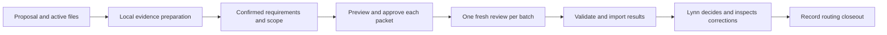

# Juliet v1 requirements and release gates

This specification incorporates Lynn's November 3, 2026 requirements and the ten-page Requirements Clarifications and Remaining Decisions addendum. The addendum reports seven confirmed, two proposed and five unresolved decision records. Its original shortened answers were not independently revalidated. Source PDFs, chats and real proposal files remain outside the repository. Page references below describe workflow evidence, not verified sponsor policy.

Youssef maintains Juliet. Lynn controls scope, findings, holds, corrected-file verification, routing and institutional submission. V1 supports real proposal processing and complete packages; new reviews are review-only. Local processing, external transmission and developer/support access remain distinct institutional permission questions. Development authorization is not institutional approval.

## Workflow

| Clarification | V1 behavior |
| --- | --- |
| Routine budget decisions and holds, addendum pp. 1–2, 7 | Missing authority leaves affected checks unresolved. Lynn chooses scoped or whole-review holds; only she clears them with a record. |
| Formula inspection, pp. 3, 6 | Inspect expressions, references and included/excluded cells. Do not automatically require or perform recalculation. Distinguish caches, independent arithmetic and a documented external engine run. |
| Revision scope and unsupported files, pp. 3, 7 | Freeze explicit active versions. Preserve originals and strict redaction guards. Show unsupported features and affected coverage; supported derivatives or attributed manual inspection can support limited review. |
| Routine narrative scope, pp. 1, 4 | Check required sections, figures, effort and cross-document consistency. No new drafting, rewriting, scientific, feasibility or wording review. |
| Approved output formats, pp. 4, 8–9 | Budget corrections and dependencies; complete-package checklist with explicit coverage. Several checks can reference one issue. |
| Corrected active files before routing, pp. 4, 8 | Lynn acknowledges inspected corrections and remaining issues in a version-bound closeout. Importing a report does not establish readiness. |

Historical sponsor profiles establish workflow diversity, not current rate tables, universal limits or applicable editions. Exact governing sources, amendments, institutional classifications and scope must be supplied per proposal. Unknown authority stays unknown.

## Local product and exchange contract

The local journal remains the record. Store neutral document labels, immutable versions/hashes, explicit active selections, confirmed checklists, round scope, packet receipts, findings and human decisions. Originals stay outside the journal. Evidence preparation is read-only; extraction and redaction are separate operations. Supported XLSX/DOCX text and formula evidence may be extracted even when strict redaction is blocked; unsupported or omitted content remains a limitation. PDFs use the existing strict text path. Legacy formats and scanned content use supported-copy/manual-evidence fallback. There is no automatic conversion, OCR, macro execution, link refresh or calculation engine.

New packet/findings v3 uses reviewer release 1.0.0. Preserve immutable v1/v2 readers. Each packet binds proposal, round, set, batch, manifest, active versions, scope, checklist and evidence. Batches contain at most 30 items, 6,000 characters per item and 60,000 evidence characters. A check's evidence stays together; narrow the selected scope if one check exceeds the batch bounds. Every assigned check returns exactly once. Incomplete sets stay visibly incomplete. The full envelope and journal retain bounded size checks before writes.

The packet includes reviewed inventory labels, guidance references, prior findings, coverage limitations and excerpts. These may contain confidential research or salary data. Preview every complete packet before approving a manual download/upload. No source file or private backup is uploaded by the app. There is no document-upload API, cloud case database or automatic plugin connection. Local journal text, quotations and manual evidence rely on the approved filesystem's access and retention settings; the app does not encrypt them.

The plugin contains only reusable review methods, contracts and fictional examples. Each batch is reviewed in a fresh chat; a cross-document check must carry all necessary evidence. Attachment instructions are untrusted. Objective errors require evidence; process judgments remain labeled suggestions. Exact citation validation establishes provenance, not relevance or correctness. Lynn checks substance.

## History and human control

- Add scoped/whole-review hold and explicit clear records. A whole hold prevents packet sealing; independent unheld checks remain available. Reading history, registering corrections and recording decisions remain possible.
- Preserve stable finding IDs through partial correction. Corrected does not mean Verified; legacy Resolved is not upgraded. Changed active evidence flags prior verification for recheck without erasing its historical decision.
- Freeze targeted or broader revision scope. Personnel formula changes can affect fringe, indirect costs, totals, forms, justification and validation; Lynn confirms applicable dependencies.
- Validate delayed reports, retain them against the original round and exclude historical imports from current findings and closeout. Reusing their conclusions requires a current recheck.
- Closeout records the active manifest, corrected files Lynn inspected, remaining issues and routing implications. No corrections required is explicit. A new routing-ready status action requires current closeout and cleared holds. Later relevant changes mark closeout outdated without silently changing proposal status.
- Preserve expanded sections/focus after saves, while selections and unsaved fields do not cross proposal boundaries. Continue fail-closed journal replay, Web Locks and stale-head checks.

## Acceptance and rollout

| Gate | Required result |
| --- | --- |
| Complete fictional package | Cover, narrative, budget, justification, personnel, facilities, subaward and validation coverage; missing letter shares a finding with the matching validation error. |
| Formula fixture | Inputs 700+200+150 yield 1,050 while saved cache is 900; excluded memo 25, stored 10.004 versus displayed 10.00, unresolved external link. No execution or automatic refresh claim. |
| Guidance/citations | Missing and conflicting sources remain unresolved; fabricated/foreign quotations fail; a genuine irrelevant quotation is assessed in blind behavioral review. |
| Isolation/batches | Same filenames and similar text across concurrent proposals do not cross identities; altered digests, foreign versions, duplicate/missing batches and stale writes fail safely. |
| Lifecycle | Partial correction, changed verified evidence, independent holds, late reports, corrected-file acknowledgment and stale closeout preserve historical human decisions. |
| Privacy and access | Source hashes unchanged; original/private-backup separation; local processing sends no content; existing signed gateway and unauthorized-request protections pass. |
| Actual reviewer | Run blind cases against the published release, import untouched reports and reopen. Record expected findings, misses, unsupported claims and format failures separately. |
| Compatibility | Legacy journals and v1/v2 imports remain readable; local/cloud regression suites, build and deployment packaging pass at the candidate commit. |

Extend the existing review-context PR, validate locally and in the authorized cloud setup, and record the exact tested commit. Merge the validated change, publish a guarded backward-compatible plugin update, read its source back and exercise the installed release. Deploy the matching website while preserving Worker identity, hostname and Access settings. Verify live version, authenticated workflow and unauthorized access separately from source tests.

Before Lynn's first operational review, verify her actual plugin access and the permitted local/external environment. Personal/private metadata alone does not establish a Lynn-only audience. Complete a representative real-package walkthrough locally with explicit scope, correction and closeout; no real upload belongs in release testing. Excel platform/template settings, formal interpretation authority and institutional handling permissions remain unverified. Engine execution claims require an actual version-bound run record; synthetic arithmetic cannot substitute for it.
