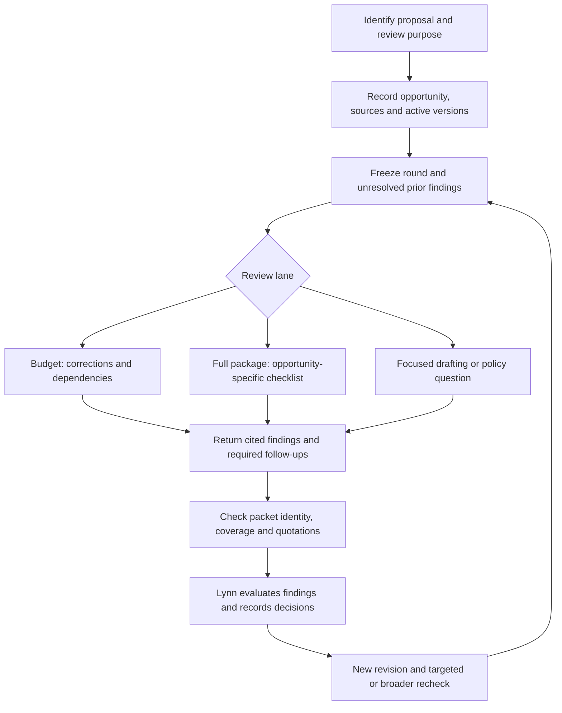

# Review requirements and implementation sequence

This plan incorporates Lynn's returned requirements dated November 3, 2026, a 13-page handoff covering workflow, proposal profiles, authority, budget checks, review history and eight fictional acceptance cases. The source PDF and case files remain outside the repository. Page references below identify the handoff, not a newly verified sponsor rule. Where the handoff labels a clarification confirmed, that means it reports Lynn's answer; the underlying conversation and every cited primary source have not been independently revalidated here.

The previous organization plan remains useful for local storage. This plan governs the complete-package review workflow. Youssef owns and maintains Juliet. Lynn controls decisions and submission through existing institutional processes.

## What the returned requirements change

| ID | Requirement | Evidence in handoff | Design consequence |
| --- | --- | --- | --- |
| LR-01 | Start with opportunity and requested scope. Budget review returns necessary corrections; full-package review returns a tailored checklist. | pp. 1–2, 9–10; US-01 | Freeze the review lane, purpose, opportunity edition and requested checks in each round. Keep focused drafting and policy questions distinct. |
| LR-02 | A local pending-work queue is sufficient. | p. 2 | Retain the dashboard, internal/sponsor dates, time zones and next actions. Do not mirror institutional systems or send messages. |
| LR-03 | Missing or conflicting guidance stays visible even if arithmetic is clean. | pp. 6–7, 9–10; T02–T03 | Bind required follow-ups to the packet and reject reports that omit them. Include an owner when known and a concrete next action. |
| LR-04 | Use current versions and carry unresolved issues forward. | pp. 2, 9–10; T06, T08 | Preserve immutable rounds, stable finding IDs, earlier evidence and human decisions. A reported correction is not verification. |
| LR-05 | Compare matching periods, roles, organizations, cost categories and bases. | p. 8 | Reusable instructions describe the matching method. Per-proposal evidence supplies the actual values and basis. |
| LR-06 | Distinguish saved values, formulas, independent calculations and Excel execution. | p. 8; T01, T04 | Record the reported calculation method and limitations. A method selection is not proof of an engine run. Single-location arithmetic can be an objective error when the cited inputs and operation establish it. |
| LR-07 | Separate objective checks from narrative judgment and rewriting. | pp. 2, 7; ED-01 | Record narrative permission per round. No routine scientific rewriting is presumed. |
| LR-08 | Preserve originals and local proposal isolation; real-data handling authorization remains unknown. | pp. 1, 10–12; US-02 | Keep the external handoff fictional-only. No new credentials, remote case storage, sharing policy or institutional approval is inferred. |
| LR-09 | Proposal-specific rules depend on the exact edition, applicability and source. | pp. 3–7, 13 | Do not turn historical profiles, numeric conventions, limits or earlier recommendations into reusable sponsor policy. |

The handoff describes 15 historical proposal profiles with different evidence boundaries. Some have primary files; others are partial summaries, drafting requests or missing outcomes. They establish workflow diversity, not a verified catalog of current requirements. Adjacent award-change and post-submission work stays distinct from proposal submission rules.

## Draft 0.2 source increment

The browser journal remains the local record. New rounds freeze review scope alongside the existing document/version inventory and a snapshot of prior open findings. Packet v2 binds that context, inventory, prior findings, required follow-ups and selected excerpts to the proposal/round IDs and digest. A digest detects changed content relative to the local registered receipt; it is not a signature or institutional attestation.

The intake carries lane, purpose, opportunity/edition summary, requested checks, scope and exclusions, guidance status, responsible role, next action, calculation evidence note, narrative permission and fictional handling state. Document metadata and excerpt anchors carry source versions and locators. Unknown opportunity, authority or applicability remains explicit. Sponsor/program/mechanism details and revision reach currently share bounded text fields; a structured authority register, period mapper and change-impact model are later increments.

The report contract requires every generated follow-up to survive import. Missing requirements and guidance cannot disappear merely because all supplied excerpts were marked reviewed. A proposal-specific follow-up can include a missing input, unresolved applicability, missing package validation, a calculation limitation or an earlier issue awaiting action. Deterministic follow-ups are a floor: the reviewer must still identify additional gaps within the supplied evidence.

New findings receive stable IDs. Linked prior findings retain their IDs. The local history records Lynn's disposition; import itself does not close findings or change status. `Corrected` records that a change was supplied or reported. `Verified` requires Lynn's decision and a current-round document/version locator. That locator records the evidence she checked; it does not prove that a complete workbook or package was tested. Legacy `Resolved` is retained as history and is not reinterpreted as `Verified`. These labels implement proposed record meanings from the handoff; they are not a previously established institutional taxonomy.

The pilot accepts at most 120 findings per report and 120 unresolved findings per proposal, with up to 300 required follow-up references per packet. JSON imports and journal entries are bounded to 8 MiB. Limits are checked before writes so an oversized record cannot make the portfolio unreadable. A report arriving after Lynn closed one of its carried issues is rejected for a new current review; retrying an already stored identical report remains safe.

The reviewer source supplies the reusable method only. It accepts fictional material, gives the appropriate output for the lane, cites supplied sponsor or institutional guidance, distinguishes arithmetic from policy and preserves prior issues. It does not contain the returned PDF, raw chats, proposal excerpts, real salary values or sponsor-specific rate tables. The full-package checklist is currently part of the readable reviewer response. The imported JSON persists excerpt coverage and findings; it does not yet persist a separate result for every checklist row. Retain the readable response locally until structured check results are implemented.

Registered v1 packets and their reports remain readable and importable under their original rules. New packet generation uses v2 and requires a round with scope. Do not rewrite old journal events, change their digests or silently upgrade a v1 report. The source package version does not establish that the account plugin was published or installed; the matching reviewer release must be tested and released separately.

## Acceptance matrix

These are release criteria, not a statement that a live reviewer or production environment has passed them. Structural validation and semantic review behavior need separate evidence.

| Test | Fictional case and required result | Automated contract coverage | Remaining behavioral evidence |
| --- | --- | --- | --- |
| T01 | Four units at 875 are requested as 3,600. Find the supported 3,500 extension and 100 difference; identify downstream totals to recheck. | Accept a cited single-location objective arithmetic finding with its calculation; reject unsupported evidence or malformed fields. | A blind reviewer must compute the result, explain the impact and avoid unsupported policy conclusions. |
| T02 | Workbook arithmetic reconciles but the exact opportunity is missing. | Required source-gap finding and next action cannot be omitted; import/reopen preserves them. | Reviewer must limit the math claim to inspected inputs and leave caps, allowability and package compliance unchecked. |
| T03 | Supplied sources prescribe conflicting bases. | Preserve both exact citations and the mandatory conflict follow-up; reject invented quotations. | Reviewer must recognize the substantive conflict, quantify only supported scenarios and request a human decision. |
| T04 | A stale saved result depends on an unresolved external link. | Freeze calculation method/limitations and retain a required follow-up where independent execution is not established. Existing preparation guards keep unsupported structures blocked. | Reviewer must distinguish caches from formulas and engine execution. A local Excel test on a fictional working copy must establish covered ranges and link handling. |
| T05 | A citation concerns another form. | Reject quotations absent from the identified item and non-guidance items used as governing sources. | Exact text matching cannot prove relevance; the reviewer must withdraw an irrelevant claim and request applicable authority. |
| T06 | A revision supersedes evidence associated with a prior finding. | Packet references must match frozen versions; original history remains; human verification records identify the checked version/location. | Reviewer must use the active version and describe supported correction evidence without deciding Lynn's disposition. |
| T07 | Two proposals share a filename and participant role. | Reject foreign proposal/round/document/packet/report/finding identities; preserve independent histories and stale-tab protections. | A blind two-case rehearsal must show no copied evidence, assumptions, rates or identities. |
| T08 | A missing quote remains missing in a revised budget. | Freeze unresolved prior issues and preserve stable IDs, owner and next action; reject omitted or foreign prior-issue links and duplicate carried IDs. | Reviewer must describe the current dependency without inventing a new issue or declaring verification. |

Additional regression gates cover old v1 imports, immutable round metadata, denied automatic approval/status fields, unsupported source structures, original-file hashes, private-backup separation and offline document handling. Browser tests must exercise actual export/import/reopen, not only direct validator calls. A valid exact quote can still support invalid reasoning; Lynn's substantive review remains necessary.

## Practical rollout

1. **Review context and findings continuity.** Validate the draft v2 contract, journal migration compatibility, two lanes, required gaps and prior-issue carry-forward with fictional fixtures. Keep live publishing, merging and production deployment distinct from source testing.
2. **Blind reviewer rehearsal.** Run T01–T08 through the candidate reviewer, import untouched reports, reopen the portfolio and compare with a predeclared answer key. Record missed findings, unsupported claims, format failures and any repair needed. A test prompt that reveals the answer does not count as blind evidence.
3. **Local document compatibility and calculation evidence.** Add a read-only intake/manual-review route for unsupported Office features and legacy workbooks before expanding redaction support. Preserve fail-closed preparation. Do not strip external links, flatten formulas or silently convert originals to make a test pass. Validate a fictional representative workbook in the intended Excel environment and record input/version, calculation mode, link treatment, covered ranges and limitations.
4. **Structured authority and reconciliation.** Add a versioned source register, explicit sponsor/institutional applicability, per-check checklist results, period/category/entity mapping and affected-check dependencies. Use supplied authority; source dates and amendment completeness need review. A conflict resolution must retain both passages, impact, human owner, decision and date.
5. **Authorized operational pilot.** Establish the permitted environment, data classes, access, retention, support access and external transmission conditions. Verify the actual audience/sharing controls. Then validate a representative approved workbook and matching justification, full package and revision with Lynn. Gate operational use on that evidence rather than synthetic tests alone.

The real-file preparation path remains limited: prior local inspection found representative workbook/Word structures rejected by the strict parser. That inspection does not justify weakening redaction guards, and it did not establish full workbook recalculation or package accuracy. Preserve source cleanup and manual-review options until a safe supported route is implemented and verified.

## Decisions that remain unresolved

| Decision | Owner | Work affected | Safe implementation while unresolved |
| --- | --- | --- | --- |
| Permitted runtime, data classes, retention, access, sharing and support access | Designated institutional security/privacy or sponsored-programs authority | Real proposal processing and any external handoff | Fictional-only reviewer, local queue, no new integration or data upload. |
| Written institutional sources, formal escalation and whole-review hold criteria | Lynn and relevant institutional or sponsor authority | Rates, classifications and final compliance/readiness determinations | Preserve source gaps and conflicts; continue independent checks and ask for the specific governing decision. |
| Excel recalculation, link refresh and rounding procedure | Lynn and workbook/template owner | Claims of engine verification, linked outputs and tolerated differences | Label evidence method and scope; show exact supported arithmetic without inventing a general tolerance. |
| Routine scientific feedback depth and rewriting | Lynn with the author | Narrative suggestions and proposed wording | Round-specific permission; comments or focused drafting only when requested. |
| Checklist layout and optional disposition labels | Lynn and Youssef | Presentation refinement | Use the explicit lane outputs and clearly labeled proposed record meanings. |

None of these decisions requires repeating ownership, complete-package scope or Lynn's decision authority. They constrain operational readiness and later features while fictional development proceeds.
